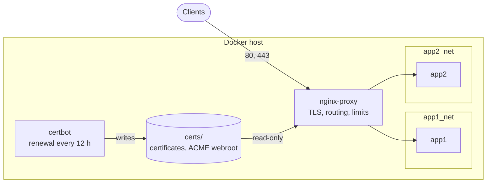

# nginx-reverse-proxy

[](https://github.com/prod-explore/nginx-reverse-proxy/actions/workflows/ci.yml)

nginx and certbot in Docker Compose, for serving several containerized web apps from one host over HTTPS. Each app stays on its own Docker network and publishes no ports. nginx joins those networks, terminates TLS with Let's Encrypt certificates and routes by host name. On every push to `main` and every pull request, CI starts the proxy and checks its behaviour from the outside.

[[Q1: Where does this run today, and since when? One sentence, e.g. "Runs on my Raspberry Pi in front of N apps", or remove this line.]]

## What it does

- **Unknown host names get nothing.** On port 80 nginx closes the connection; on port 443 it refuses the TLS handshake without presenting a certificate. Scanning the IP address reveals neither a page nor the names of the hosted sites.
- **HTTPS only.** Port 80 redirects to HTTPS and serves nothing but the ACME challenge. TLS 1.2 and 1.3 with forward-secret AEAD ciphers (Mozilla's "intermediate" profile without the DHE suites), HTTP/2.
- **Response headers.** HSTS, `nosniff`, `Referrer-Policy` and `X-Frame-Options` on every response. No nginx version in `Server`; the backend's `X-Powered-By` is removed.
- **A client address the backend can trust.** `X-Forwarded-For` and `X-Real-IP` come from the TCP connection. Whatever the client sent in `X-Forwarded-For`, `Forwarded` or `Proxy` (httpoxy) never reaches the backend.
- **No dotfiles.** Requests for paths such as `/.git/config` or `/.env` get `403` from the proxy, whatever the backend would have answered.
- **IPv4 and IPv6 clients, each by its own address.** The proxy's network has IPv6, so Docker hands IPv6 connections to nginx directly instead of relaying them; logs, rate limits and `X-Forwarded-For` see the real client address over both protocols.
- **Per-client limits.** Request rate and concurrent connections per IPv4 address or IPv6 `/64`, a stricter zone for login endpoints, `429` when exceeded.
- **WebSockets and server-sent events.** Upgrade requests are passed on for every site; a streaming variant turns off buffering and allows one-hour timeouts.
- **Backends resolved per request.** A backend that is down, or not created yet, does not keep nginx from starting; only its own site fails until it is back.
- **Certificates renew without intervention.** certbot checks twice a day; nginx reloads every 6 hours to pick up renewed files.
- **A hardened nginx container.** Read-only root filesystem, every capability dropped except the four nginx needs, `no-new-privileges`, memory and process limits.

[`scripts/smoke-test.sh`](scripts/smoke-test.sh) checks most of this against a running proxy; the rest are settings you can read in [`nginx/`](nginx) and [`docker-compose.yml`](docker-compose.yml). Part of its output:

```text
== Unknown hosts
ok   HTTP to an unknown host gets the connection closed (444)
ok   TLS to an unknown host is refused without a certificate
== Client address
ok   a forged X-Forwarded-For/X-Real-IP does not reach the backend
ok   X-Forwarded-For is the peer address, the same as X-Real-IP
ok   the Forwarded header is dropped
ok   the Proxy header (httpoxy) is dropped
== Rate limiting
ok   login allows 1 + burst of 5, then answers 429
== Reload (scripts/reload.sh, the step after every change)
ok   reload.sh tests and reloads the read-only container
ok   a replaced nginx.conf takes effect on reload
```

## Try it locally

No domain or open ports needed. You need Docker Engine 27 or newer with IPv6 enabled in the kernel (the default on Linux), Compose v2.24.4 or newer, `openssl` and `curl`.

```sh
git clone https://github.com/prod-explore/nginx-reverse-proxy.git
cd nginx-reverse-proxy
scripts/smoke-test.sh
```

The script starts the proxy from `docker-compose.yml` with every site in [`examples/`](examples), throwaway certificates and a stub backend that echoes the headers it receives. It then sends real requests and prints one line per check. It runs as its own Compose project on random loopback ports, so it does not touch a proxy already running on the host, and it removes everything when it exits.

## Deploy on a server

You need a Linux host with IPv6 enabled in the kernel (the default; the proxy's network uses IPv6, and the proxy does not start without it), Docker Engine 27 or newer and Compose v2, ports 80 and 443 reachable from the internet, and a DNS record for your domain that points to the host. IPv6 needs a few host-side steps, listed in [operations](docs/operations.md#ipv6). [[Q2: Which architectures have you run it on (amd64, arm64 / Raspberry Pi)? I will state only what you confirm.]]

**1. Clone and set two variables.** The rest of the commands use them.

```sh
git clone https://github.com/prod-explore/nginx-reverse-proxy.git
cd nginx-reverse-proxy
DOMAIN=app.example.com    # its DNS record points to this host
EMAIL=you@example.com     # for the Let's Encrypt account
```

**2. Give the app its own network and let the proxy join it.** The placeholder app below runs the nginx image pinned in `docker-compose.yml`, read from it with `docker compose config --images`; replace it with yours. An app with its own Compose file attaches to the network as shown in [`docker-compose.override.example.yml`](docker-compose.override.example.yml).

```sh
docker network create app_net
docker run -d --name app --network app_net "$(docker compose config --images nginx)"
cat > docker-compose.override.yml <<'EOF'
services:
  nginx:
    networks: [default, app_net]
networks:
  app_net:
    external: true
EOF
```

**3. Start the proxy.**

```sh
docker compose up -d
```

**4. Get a certificate.** nginx will not load a site whose certificate file does not exist yet, so every site starts as a copy of [`site-before-certificate.conf.example`](examples/site-before-certificate.conf.example), which serves only the ACME challenge on port 80. Copy it, and in the copy replace `app.example.com` with your domain:

```sh
cp examples/site-before-certificate.conf.example "sites/$DOMAIN.conf"
```

Then load it and issue the certificate. The certbot service's entrypoint is the renewal loop, so a one-off command overrides it.

```sh
scripts/reload.sh
docker compose run --rm --entrypoint certbot certbot certonly --webroot -w /var/www/certbot \
  -d "$DOMAIN" --email "$EMAIL" --agree-tos --no-eff-email
```

**5. Replace it with the full site.** Copy [`site.conf.example`](examples/site.conf.example) over the same file, and in the copy replace every `app.example.com` with your domain and `app:3000` with the app's `<container name>:<port>` (`app:80` for the placeholder app):

```sh
cp examples/site.conf.example "sites/$DOMAIN.conf"
```

After editing the copy, load it and check:

```sh
scripts/reload.sh
curl -I "https://$DOMAIN"
```

Renewal needs nothing more. Sites with a frontend and an API in separate containers, streaming sites, several names on one certificate, removing a site and updates are in [docs/operations.md](docs/operations.md).

## How it works



| Path | Contents |
| --- | --- |
| [`nginx/nginx.conf`](nginx/nginx.conf) | http-wide defaults every site inherits: logging, client timeouts, body size, gzip, rate-limit zones, Docker's DNS resolver |
| [`nginx/snippets/`](nginx/snippets) | pieces a site includes: TLS, security headers, proxy headers, timeouts, streaming, ACME challenge |
| [`nginx/conf.d/00-default.conf`](nginx/conf.d/00-default.conf) | the catch-all servers for unknown hosts and the loopback health endpoint |
| [`examples/`](examples) | site templates to copy into `sites/`; CI validates and runs every one of them |
| `sites/*.conf` | your sites; gitignored, they stay on the server |
| `certs/` | Let's Encrypt state and the ACME webroot; gitignored |
| [`scripts/`](scripts) | `reload.sh` (test, then reload the running proxy), `check.sh` (`nginx -t` on everything) and `smoke-test.sh` |

One property was a requirement from the start: **nginx starts even when some backends are not running.** Each site passes its backend to `proxy_pass` through a variable, and `nginx.conf` points the resolver at Docker's embedded DNS (`127.0.0.11`). nginx then looks the name up when a request comes in (answers cached for 30 seconds) instead of once at startup. A missing backend fails its own site, not the start of the proxy. The cost: no keepalive connections to backends, and `proxy_pass` passes the request URI unchanged, so stripping a path prefix needs a `rewrite`.

The rest of the setup, and what it costs:

- **Sites are files, not container labels.** Each site is a plain nginx server block copied from an example. Nothing discovers containers, so neither container mounts the Docker socket, which is root-equivalent on the host. Traefik's Docker provider and nginx-proxy work from that socket and configure sites on their own; here, adding a site is a manual edit and a reload.
- **One network per backend.** The proxy joins every backend network; backends share none, so they cannot reach each other. Adding a network to the override recreates the nginx container, a few seconds without service for every site; `docker network connect` avoids that (see [operations](docs/operations.md#adding-a-backend-network)).
- **HTTP-01 through a shared webroot.** certbot writes challenge files into `certs/www`, which nginx serves on port 80. Issuing and renewing never stop nginx. The cost: no wildcard certificates (those need DNS-01), and every name must resolve to this host with port 80 open.
- **Two timers, no hook.** certbot renews on its own schedule and nginx reloads every 6 hours, so a renewed certificate is served at most 6 hours late. certbot renews long before expiry, so the delay does not matter, and the certbot container needs no way to signal nginx (that would take the Docker socket or a shared process namespace).
- **Limits are declared globally and applied per location.** `nginx.conf` defines the rate and connection zones; each location chooses which to apply, so a login endpoint can be stricter than the rest of the site. Security headers sit at server level because an `add_header` inside a location discards every inherited one.

The defaults (timeouts, limits, body size, gzip) and the rules for using the snippets are in [docs/configuration.md](docs/configuration.md).

## Security model

Only nginx is reachable from outside, on ports 80 and 443. Backends publish no ports, and each sits on its own network.

- **TLS** follows Mozilla's intermediate profile without DHE: TLS 1.2 and 1.3, ECDHE with AES-GCM or ChaCha20-Poly1305. Session tickets are off. There is no OCSP stapling, because Let's Encrypt certificates no longer name an OCSP responder.
- **Client address.** The proxy assumes it is the only hop in front of the backend. It overwrites `X-Forwarded-For` with the TCP peer address, so a backend should trust exactly one proxy hop (in Express, `trust proxy` set to `1`).
- **Response headers.** The proxy sets the headers that do not depend on the application. `Content-Security-Policy` is left to the application, which knows what it loads.
- **Containers.** nginx runs with a read-only root filesystem, `tmpfs` for its scratch directories, all capabilities dropped except `NET_BIND_SERVICE`, `CHOWN`, `SETUID` and `SETGID`, `no-new-privileges`, and memory, process and log-size limits. Its health endpoint listens on the container's loopback only.

There is no web application firewall, no authentication layer and no protection against floods larger than per-client limits can absorb. The full model, threat by threat with the file that handles each, is in [docs/security-model.md](docs/security-model.md). To report a vulnerability, see [SECURITY.md](SECURITY.md).

## When things fail

| Event | What happens |
| --- | --- |
| A backend stops or is removed | Its site answers `502` or `504`; other sites are unaffected. It recovers without a reload when the backend is back. |
| A site file has an error, such as a certificate path that does not exist | `nginx -t` fails and nothing is reloaded; the running configuration keeps serving, and so does the 6-hourly reload. **But a restart of the container then fails, and every site is down until the file is fixed.** Apply every change with `scripts/reload.sh`, which tests before it reloads. |
| A renewal fails | certbot logs it (`docker compose logs certbot`) and tries again 12 hours later. The current certificate is served until it expires. |
| The health check fails | `docker compose ps` shows the container as unhealthy. Docker does not restart it on its own. |
| The host reboots | Both containers start again (`restart: unless-stopped`). |

## Known limits

- **One host, one nginx.** There is no failover. Fixed container names (`nginx-proxy`, `certbot`) allow one instance per Docker host.
- **Certificates are issued by hand,** one command per site, through HTTP-01 only.
- **Behind a CDN or another proxy,** nginx sees that proxy's address. Rate limits then apply to the CDN, and the backend gets the CDN's address. Recovering the client address needs `real_ip` configuration, which is not included.
- **IPv6 depends on the host.** The repository enables it on the proxy's network; the host must keep Docker's `ip6tables` on and have a public IPv6 address open on 80 and 443 (see [operations](docs/operations.md#ipv6)). A host whose kernel has IPv6 disabled cannot start the proxy as configured.
- **gzip and BREACH.** gzip is on, including for `text/html`. A page that reflects attacker-controlled input next to a secret, such as a CSRF token, should turn gzip off.
- **HSTS with `includeSubDomains`.** Deployed on an apex domain, it forces HTTPS on every subdomain. Check those first.
- **The certbot container is not hardened like nginx.** It keeps a writable root filesystem and Docker's default capabilities. It publishes no ports.

## Development

| Command | What it checks |
| --- | --- |
| `shellcheck -x scripts/*.sh` | the scripts |
| `scripts/check.sh` | `nginx -t` with the image from `docker-compose.yml`: every example together, then the before-certificate example alone, with throwaway certificates |
| `docker compose config -q` | the Compose file, alone and with `-f docker-compose.yml -f docker-compose.override.example.yml` |
| `scripts/smoke-test.sh` | the running proxy, from the outside |

[CI](.github/workflows/ci.yml) runs all four on every push to `main` and every pull request. Dependabot opens weekly updates for the pinned images and the GitHub Actions; nginx updates stay on its stable branch, and moving to the next stable branch is a manual change.

## License

[MIT](LICENSE)
